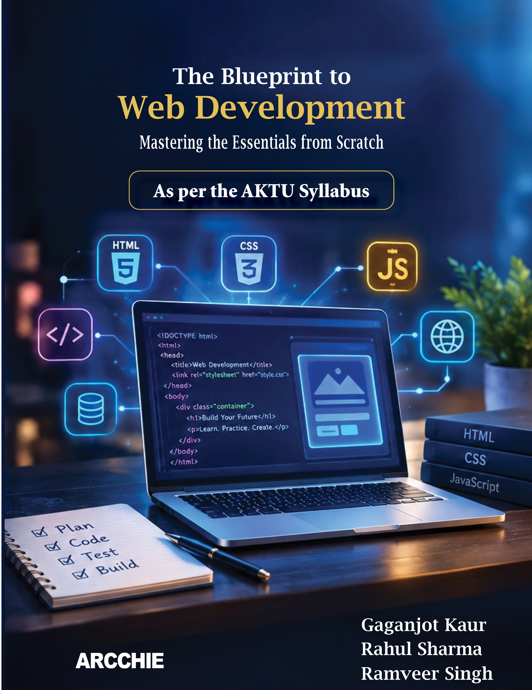

# The Blueprint to Web Development: Mastering the Essentials from Scratch

## Overview
Welcome to the repository for the book [The Blueprint to Web Development: Mastering the Essentials from Scratch](https://www.amazon.com/dp/B0D95XJ2RK) published by [Arcchie Publications](https://arcchieonline.com). This repository contains resources, code examples, and supplementary materials related to the book. Whether you're a reader of the book or an author, this readme provides essential information about the repository's contents.

## Table of Contents

1. [About the Book](#about-the-book)
2. [Repository Contents](#repository-contents)
3. [Getting Started](#getting-started)
4. [Aabout the Authors](#about-the-authors)
5. [Feedback and Contributions](#feedback-and-contributions)
6. [License](#license)
7. [Community](#community)

## About the Book

The Web is the most accessible canvas that people have built for themselves. The students can create something that can be seen by billions of people with nothing more than a text editor and a browser. There are so many languages, tools, frameworks, and changing standards to learn, and you have to learn them all before you can start designing! Web Design for Students is designed with one thing firmly in mind: Learning how to design for the web should be an enjoyable experience. All the concepts presented here are presented for a reason. All the lines of code will have an observable effect. All exercises are real-world; no abstract things that aren't real. It all starts with structure: that's where we start! HTML is the skeleton of every page that has been ever visited. Following that is JavaScript, that interaction to pages that would otherwise remain inert. The students will also have the notions of modern web development: responsive design that is adapted towards screen sizes; accessibility that makes the work usable for all people; habits for performance that will respect visitors. These are not the high-level concepts that students will learn later in the course, but rather concepts that are built in from the ground up. This book is designed to be read by students: students who are learning about web development in a classroom or in a self-study program. While the web evolves every day, the basics students build here will remain the strong foundation that underlies all the tools and trends that'll be used in the coming years.
This book is intended to serve as a comprehensive and accessible resource for readers seeking to develop a sound understanding of the principles and practices of web designing. It is suitable for beginners as well as undergraduate and postgraduate students, educators, and readers interested in acquiring both conceptual knowledge and practical skills in the field. The content has been organized in a systematic manner to support progressive learning and effective understanding of fundamental and contemporary web-designing concepts. The content of this book is prepared in accordance with the curriculum prescribed by Dr. A.P.J. Abdul Kalam Technical University, Lucknow (AKTU) and is suitable for relevant B.Tech. courses..

## Repository Contents

- **/code-examples**: This directory contains code examples discussed in the book.
- **/resources**: Supplementary resources, such as data files or additional reading materials, colored images can be found here.
  
## Getting Started

To get started with the book and the materials in this repository:

1. Clone this repository to your local machine using `git clone`.
2. Explore the `/code-examples` directory for hands-on coding examples.
3. Review the `/resources` directory for additional resources mentioned in the book.

## About the Authors

**Gaganjot Kaur** is a dedicated academician in the field of Computer Science with more than 19 years of teaching experience in academia and research. She is currently pursuing her Post Doc. in Computer Science & Engineering from Lincoln University College, where she specializes in Advancing Detection Mechanisms for DDoS Attacks Using Natural Language Processing in Software-Defined Networking (SDN). She is currently working as an Associate Professor in the Department of Computer Applications at Raj Kumar Goel Institute of Technology, located in Ghaziabad. In her role, she is actively involved in teaching undergraduate students, mentoring projects, and contributing to academic development within the department. She is the author of more than 50 published papers, most of them published in SCI, Scopus journal, IEEE international conferences. Her area of research includes Machine Learning, Biomedical, Software Defined Networks, Cloud Computing, Network Security, Blockchain, IOT, Machine Learning and Database Management Systems. She also has in her credit various certificates for successfully completing NPTEL courses, Infosys certificates. She is also the co-author of the book Digital Twin Revolution Enabling Smart Industries and Cyber - Physical Systems, Cloud Computing, Computer Organization & Architecture designed for computer science engineering graduates. She has also delivered lectures on topics like Gen AI & LLM and AI in sustainable building energy management and has actively participated in various panel discussions. She is also certified Microsoft Azure Fundamentals and Microsoft Azure Data Fundamentals. She is also the senior member of Institute of Electrical & Electronics Engineers, the lifetime member of Institute of Scholars under Govt. of India. Throughout her career, she has received several prestigious awards, recognizing excellence in both academia and industry. These accolades include the National Educationist Award of Honour as an Excellent Educator 2026, IRSD Women Academic & Research Excellence Award 2026, Best Educator by RASHTRIYA ASHOKA SAMMAAN in Dec 2025, Academic Excellence Award 2024, Research Excellence Award 2024, Award for outstanding contribution to Education Community 2023, Certificate of Achievement Zenith and the Ace the Excellence Award, which honours her outstanding contributions and dedication. Her two-year tenure in the corporate sector was marked by significant achievements wherein she was recognized with the Best Employee Award and the Star Performer Award, reflecting her exceptional performance and dedication. She strongly believes that there is no age for learning, a philosophy that drives the continuous pursuit of knowledge and improvement. 

**Rahul Sharma** is presently pursuing a Doctor of Philosophy (Ph.D.) in Computer Science & Engineering from Galgotias University, Greater Noida. His research focuses on advanced applications of Machine Learning and Deep Learning, aiming to solve complex real-world problems. He holds both a Bachelor of Technology (B.Tech.) and a Master of Technology (M.Tech.) in Computer Science & Engineering from Dr. A.P.J. Abdul Kalam Technical University (AKTU), Lucknow, Uttar Pradesh. His strong academic foundation has enabled him to develop a keen interest in cutting-edge technologies, leading to impactful research contributions in deep learning in the agriculture sector. With over 14 years of teaching experience, Rahul has played a pivotal role in shaping the careers of numerous students. His teaching methodology emphasizes conceptual clarity, hands-on practice, and real-world applications, making complex topics accessible and engaging for learners. Over the years, he has guided several undergraduate and postgraduate students in their academic projects, helping them explore emerging fields such as artificial intelligence, data analytics, and computer vision. He is also a member of the Computer Society of India (CSI). He is the author of more than 10 research papers in various international, national conferences and journals. He has been recognized Reviewer for Springer and IEEE journals, evaluating cutting-edge research papers in AI and data science. Mr. Sharma’s remarkable contributions to academia and research have earned him several accolades and honors, including National Teacher Award 2024 by Saksham Society for outstanding teaching methodologies and commitment to student success. He has earned NPTEL certifications in Big Data Computing, Advanced Computer Network etc. Beyond classroom teaching, Mr. Sharma has been a mentor and guide to students participating in hackathons, coding competitions, and research projects.

**Ramveer Singh** is currently pursuing a Doctor of Philosophy (Ph.D.) in Computer Science & Engineering, where his research focuses on advanced computing technologies, artificial intelligence, and cybersecurity. He holds a Bachelor of Technology (B.Tech.) degree in Information Technology from Dr. A.P.J. Abdul Kalam Technical University (AKTU), Lucknow, and a Master of Technology (M.Tech.) from the prestigious Birla Institute of Technology (BIT) Mesra. His strong academic foundation has fueled his interest in data science, machine learning, and emerging technologies, enabling him to contribute significantly to academia and research. With an impressive 19+ years of experience in teaching and academic administration, Mr. Singh has played a pivotal role in guiding students and faculty members alike. Over the years, he has taught a wide range of subjects, including Artificial Intelligence and Machine Learning, Data Structures and Algorithms, Database Management Systems, Cybersecurity and Ethical Hacking, Software Engineering and Cloud Computing. In addition to his teaching responsibilities, Ramveer has served in key administrative roles, including academic coordinator, research supervisor, and department head, where he has successfully led curriculum development, faculty training programs, and institutional collaborations. His leadership has been instrumental in fostering a research-driven academic environment. As an avid researcher, Mr. Singh has authored and co-authored several research papers in reputed national and international conferences and journals. His research primarily focuses on machine learning algorithms, cybersecurity enhancements, data science applications, and cloud computing. Mr. Singh’s remarkable contributions to academia and research have earned him several accolades and honors, including National Excellent Faculty Award for outstanding teaching methodologies and commitment to student success. He has also collaborated with industry leaders and research organizations, working on projects that integrate academic knowledge with real-world applications. His strong industry connections have facilitated internship and placement opportunities for students, enabling them to work with top technology firms. Beyond teaching, Mr. Singh is a mentor and guide to students in their research projects, technical competitions, and entrepreneurial ventures. Mr. Ramveer Singh’s dedication to teaching, research, and academic leadership makes him a pillar of excellence in the field of Computer Science & Engineering.

## Feedback and Contributions
We value your feedback and contributions to make this resource even better. If you find errors in the book, issues in the code examples, or have suggestions for improvement, please open an issue in this repository. If you'd like to contribute directly, you're welcome to fork the repository, make your changes, and submit a pull request.

## License
This repository and its contents are licensed under [Apache License 2.0]. Please review the [LICENSE](LICENSE) file for detailed terms and conditions.

Happy reading and coding!

## Community
Join Our community at: [Discord](https://discord.gg/z26SenmpEt)
